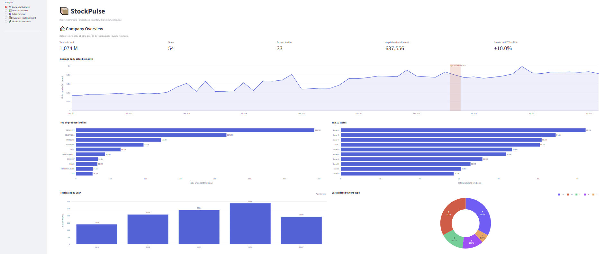

# 📦 **StockPulse :** Real-Time Demand Forecasting & Inventory Replenishment Engine

StockPulse forecasts daily product demand for a retail chain and turns the forecast into inventory decisions: when to reorder, how much to order, and how much safety stock to hold. It is built on the Corporación Favorita grocery sales data and delivered as an interactive Streamlit dashboard.


## 🛠️ Tech Stack

<p align="left">
  
  
  
  
  
  
  
  
  
</p>


## 🎬 Demo

*Click the image to watch the demo video.*

[](doc/demo.mp4)


---

## Highlights

- **Forecasting model:** LightGBM regressor trained on `log1p(sales)` with a strict time-based split (the last 16 days are held out).
- **Test performance:** R² **0.9404**, MAE **89.52**, RMSE **304.67**, RMSLE **0.4847** (units, on the held-out period).
- **Honest benchmark:** versus a simple "same store and product, 7 days earlier" forecast (MAE 100.23), the model's error is about **10.7% lower**.
- **Decision support:** reorder point, suggested order quantity and statistical safety stock instead of a flat percentage buffer.
- **One pipeline everywhere:** the app, the dashboard and the validation script share a single feature pipeline, so they cannot drift from training.

## Dashboard pages

| Page | What it shows |
|---|---|
| 🏠 Company Overview | Total sales, stores, product families, growth, monthly trend, top products and stores, sales by year and store type |
| 📊 Demand Patterns | Day-of-week and day-of-month effects, seasonality heatmap, promotion vs no promotion, holiday effect |
| 🔮 Sales Forecast | Single prediction for a chosen date, store, product family and promotion count, compared with recorded sales for historical dates |
| 📦 Inventory Replenishment | Multi-day forecast with uncertainty band, reorder point, safety stock, days of cover, suggested order, projected stock level |
| 🧪 Model Performance | R², MAE, RMSE, RMSLE, benchmark comparison, actual vs predicted, error by product family, feature importance |

## Dataset

[Store Sales - Time Series Forecasting (Corporación Favorita)](https://www.kaggle.com/code/ryanholbrook/exercise-forecasting-with-machine-learning/input).

- 3,000,888 daily rows, 54 stores, 33 product families, 2013-01-01 to 2017-08-15
- Supporting tables: store metadata, oil prices, holidays and events

The dataset is  included in this repository under `data/raw/`.

## Method

1. **Cleaning and merging:** join train, stores, oil prices and holidays; remove transferred and duplicate holidays; forward-fill oil prices; keep genuine sales spikes and handle them with a log transform.
2. **Feature engineering:** calendar features (year, month, day, weekday, weekend), promotion count, oil price, store attributes, and event flags (mega promotion, 2016 earthquake period, December).
3. **Preprocessing:** one-hot encoding (`OneHotEncoder`), standard scaling, `log1p` target.
4. **Modelling:** Linear Regression baseline, then LightGBM; time-series cross-validation (`TimeSeriesSplit`); feature selection from 116 to 57 features by importance; hyperparameter tuning with Optuna (15 trials).
5. **Evaluation:** chronological hold-out of the last 16 days, plus a paired significance test against the 7-day-ago benchmark.
6. **Inventory logic:** `reorder point = lead-time demand + safety stock`, with `safety stock = z × σ × √lead time`, where σ is the model's typical daily error on the held-out period.

## Model selection process

| Step | What was done | Why | Result |
|---|---|---|---|
| 1. Baseline | Linear Regression on `log1p(sales)`, one chronological split | A simple, fast, explainable model sets the bar every later model must beat. `log1p` is used because sales are heavily right-skewed with spikes and many zeros | Test R² 0.83 (log scale), looked good but was optimistic |
| 2. Time-series cross-validation | 5-fold `TimeSeriesSplit` on the linear model | One split can be lucky. Sales are ordered in time, so random folds would leak the future into training. Expanding-window folds mimic real forecasting and show how stable a model is | Mean test R² 0.706, RMSLE 1.432. Train R² was also low (0.756), so the model **underfits** |
| 3. Tree-based model | LightGBM, evaluated with the same CV | A linear model cannot capture interactions such as store × product × promotion × weekday. Gradient-boosted trees learn them automatically and are fast on 3M rows. Same CV keeps the comparison fair | Mean test R² 0.804 (+0.098), RMSLE 1.169, stable across folds. Train R² 0.888 vs test 0.804 shows some overfitting |
| 4. Feature selection | Removed the 59 features with zero split importance (116 to 57) | Many one-hot columns were never used. Fewer inputs mean faster tuning and a simpler app | 57 features kept. Selection used a small 100-tree model, so rarely used columns can be dropped |
| 5. Hyperparameter tuning | Optuna search (15 trials) scored with the same time-series CV | The defaults were a guess, and the train/test gap in step 3 showed the model needed a better bias/variance balance (trees, depth, leaves, learning rate). Optuna searches more efficiently than a grid | CV RMSLE improved from 1.169 to 0.995 |
| 6. Final model | Trained on the full training period, then evaluated once on the last 16 days | The held-out days were never used for tuning, so this is an honest check on unseen data | R² 0.9404, MAE 89.52, RMSE 304.67 (units) |
| 7. Event flags | Created `is_mega_promo`, `is_earthquake_period`, `is_december` and re-ran the whole pipeline | Domain knowledge: the 2016 earthquake spike, the December season and very large promotions are special cases the model might mis-learn | Two full runs: R² 0.9160 (MAE 104.39) without flags and R² 0.9404 (MAE 89.52) with flags. The flags had zero split importance, so the gap is mainly explained by Optuna choosing different hyperparameters |

Notes:
- Steps 1 to 5 are on the log scale (RMSLE, R² of `log1p(sales)`). Step 6 and 7 are in units on the held-out period, so the two groups should not be compared directly.
- The two runs ended with 57 selected features each, and their LightGBM cross-validation scores were identical to four decimals, so the flags were evidently not used by the final model (check: none of the three flag names is in `important_features`). The difference between the runs comes from the tuned hyperparameters (204 vs 381 trees, different `colsample_bytree`), not from the flags.
- Consequence: the held-out result is sensitive to the tuning run. The 0.9160 model (MAE 104.39) is worse than the simple 7-day-ago benchmark (MAE 100.23), while the 0.9404 model beats it by about 10.7%. A fixed-hyperparameter comparison and lag features are planned to make the gain more robust.

## Notebooks

| Notebook | Purpose | Held-out result |
|---|---|---|
| `data_cleaning_withflug.ipynb` | Final pipeline. The files in `data/models/` and the dashboard come from this notebook | R² 0.9404, MAE 89.52 |
| `data_cleaning_withoutflug.ipynb` | The same pipeline without the three event flags, kept as a comparison run. Not used by the app | R² 0.9160, MAE 104.39 |

Why do the two runs differ? The flags received zero split importance in the feature-selection model, so neither final model contains them. The gap comes from the hyperparameters Optuna chose in each run (204 vs 381 trees, different `colsample_bytree`), which can shift when the feature order changes. See the notes under *Model selection process*. Some commentary cells in the notebooks were written before this comparison, so where they disagree with this README, the README is correct.

## Project structure

```
StockPulse/
│ 
├── README.md
│
├── requirements.txt
├── .gitignore
│
└── docs/
│     ├── demo.mp4
│     └── demo-thumbnail.png
│ 
├── app/
│   ├── app.py                     # Streamlit dashboard (5 pages)
│   ├── dashboard_utils.py         # Aggregations, charts, replenishment logic
│   ├── features.py                # Shared feature pipeline (training-consistent)
│   └── validate.py                # Reproduces the notebook's test metrics
│ 
├── data/
│   ├── raw/                       # Kaggle files
│   │   ├── train.csv
│   │   ├── stores.csv
│   │   ├── oil.csv
│   │   └── holidays_events.csv
│   │ 
│   ├── models/                           # Saved artifacts used by the app
│   │   ├── lgbm_sales_model.joblib
│   │   ├── scaler.pkl
│   │   ├── onehot_encoder.pkl
│   │   ├── columns.pkl                   # the 57 selected features
│   │   ├── feature_columns.pkl           # all 116 features, training order
│   │   └── store_metadata.pkl
│   │ 
│   └── df_merged.csv                     # Merged dataset the app reads (created by the notebook, not in the repo)
│
└── notebook/
    ├── data_cleaning_withflug.ipynb       # Final pipeline (used by the app)
    ├── data_cleaning_withoutflug.ipynb    # Same pipeline without the event flags (comparison run)
    └── df_merged.csv                      # Written by the notebook; copy it to data/ (not tracked)
```

## Getting started

```bash
# 1. Create an environment and install dependencies
python -m venv .venv
source .venv/bin/activate          # Windows: .venv\Scripts\activate
pip install streamlit pandas numpy scikit-learn lightgbm joblib plotly scipy optuna matplotlib seaborn

# 2. Run notebook/data_cleaning_withflug.ipynb (the raw files are already in data/raw/)

# 3. Launch the dashboard
streamlit run app.py
```

## Limitations

- The model has **no lag features** (recent sales of the same store and product). This is why it beats the 7-day-ago benchmark by only about 10.7%.
- It does not know **future holidays, promotions or oil prices**. Forecasts beyond the data assume normal working days, the promotion level you enter, and the last known oil price.
- Safety stock uses an error estimate from only 16 held-out days, so treat it as approximate.
- The data is a **historical snapshot** ending on 2017-08-15; the dashboard does not connect to a live data feed.
- R² is dominated by high-volume families such as GROCERY I, so check the error-by-family chart before drawing conclusions about small products.


## 👤 Author

- **GitHub:** [@bithiNath](https://github.com/bithiNath)
- **LinkedIn:** [Bithi Nath](https://linkedin.com/in/bithinath)


 <br>
 
## 📄 License
 
This project is licensed under the MIT License — see the LICENSE file for details.
 
<br>
 
## 🙏 Acknowledgements
 
- Dataset is synthetic and created purely for educational and portfolio purposes
- Built as part of a self-learning journey in Data Analytics
- Tools used: Python, PostgreSQL, Power BI Desktop, VS Code, Git
 
<br>

-----
<p align="center">⭐ If you found this project helpful, please consider giving it a star on GitHub!</p>


<p align="center">Developed by <a href="https://github.com/bithiNath">@bithiNath</a> ⚡</p>
